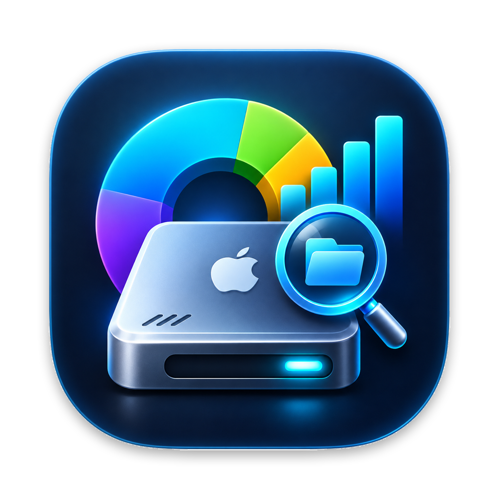

# Mac Storage Intelligence

A native macOS storage manager: measure what is using disk, browse and search every
accessible folder, discover developer caches and AI models, monitor changes in real
time, and delete selected files or resources safely. Everything runs locally, with
no account, subscription, network service or API key.



## Screens

- **Overview** — actual capacity (total, available, occupied, system-managed/shared,
  measured user data, potentially recoverable and unknown/inaccessible), a prominent
  recoverable-storage metric, scan progress and permission limits, discovered
  applications/AI models/downloads/caches/large files, and the latest cleanup outcome.
- **Storage explorer** — breadcrumb file browser with expandable monitored tree,
  treemap, hidden-file visibility, type filtering, search, sorting by name, size,
  type and modification date, file metadata, Quick Look preview, Finder reveal,
  multi-selection and per-item or bulk deletion.
- **Large files** — the largest measured files or directories across monitored
  volumes, with the same filters and deletion actions.
- **Applications** — installed `.app` bundles with measured size, associated
  support-folder discovery, and Trash-based removal with warnings.
- **AI models** — Ollama models through the local service, Hugging Face cached
  repositories through the `hf` CLI, and standalone GGUF/ONNX/safetensors weights
  found in supported inference folders or scan results.
- **Developer storage** — npm, pnpm, yarn, uv and Homebrew caches with their own
  cleanup commands, plus Docker/Colima containers and images with per-resource
  removal. Protected volumes are listed but not removable.
- **Cleanup** — measured candidate locations classified as Safe to Clean, Review
  Required or Protected, with explanations, estimates, individual controls and
  bulk selection for eligible official-tool or high-risk file deletion.
- **History** — every deletion attempt, its outcome, and the observed available
  space change.
- **Settings** — volume inventory toggles, custom exclusions, monitoring status,
  permission guidance and safety notes.

## Measured storage analysis

- Launch resolves the signed-in account home dynamically through Foundation. The
  saved scan target is validated as an existing readable user directory; the old
  `/System/Volumes/Data/home` firmlink path is rejected and replaced with the actual
  home instead of being resumed as an empty zero-byte scope.
- The home scan retains the complete accessible directory tree needed for folder
  sizes and standard cleanup locations, rather than stopping inside a large branch
  and leaving most folders permanently unmeasured. Cleanup ancestors are retained
  even if a future directory budget is reached.
- Applications under `/Applications` are measured automatically as a separate,
  non-overlapping root. AI-model folders, Downloads, Caches and the largest files
  are surfaced from measured home data.
- The breakdown keeps seven distinct values: total capacity, available storage,
  occupied storage, system-managed/shared storage, measured user data, potentially
  recoverable storage, and unknown/inaccessible storage. Potentially recoverable is
  the sum of measured, currently deletable cleanup candidates only.
- Nested measured roots are counted once. Hard links and duplicate directories are
  deduplicated by the scanner, cleanup candidates are disjoint, and shared/reserved
  APFS bytes are never added to occupied storage a second time. Snapshots and shared
  blocks can still keep allocated space after removal, so estimates are not presented
  as guaranteed recovery.
- Choosing a folder in Storage Explorer only changes the browser location. It does
  not replace the monitored inventory scope. Folders outside a retained scan branch
  are measured on demand for their immediate children; permission failures are shown
  as unavailable rather than permanently unmeasured.

## Recoverability-based deletion policy

Every deletion candidate receives one of four classifications before any action is offered:

- **Verified recoverable** — an installed, official cleanup mechanism was detected (for
example the npm/pnpm/yarn/uv/Homebrew executable, or Apple’s bundled pip). The exact
resource, size, consequences and restoration steps are shown; deletion uses that
mechanism permanently and is confirmed once.
- **Partially recoverable** — the software can be restored but local state may not be
  (installed applications, Ollama/Hugging Face models, stopped Docker containers).
  Deletion is offered only for the exact selected resource and requires a separate
  high-risk confirmation where `DELETE` must be typed. Associated data is never
  removed implicitly.
- **Unknown recoverability** — no restoration mechanism could be verified (ordinary
  user files, logs, temporary files, untagged Docker images). Files can be inspected
  and advanced deletion is possible only after the same typed high-risk confirmation.
  App-managed locations without a supported interface are not deleted generically.
- **Protected** — system paths, active resources, shared model stores, Docker volumes,
  databases and VM disks. Deletion is disabled and the reason is shown.

Classification requires evidence, never a filename, extension or download URL. Results
after deletion list completed and failed operations, estimated reclaimable bytes, the
observed available-space change (when measurable), and restoration instructions.

## Deletion

Selected items are inspected immediately before deletion: path components are
opened without following symlinks, the containing directory is pinned, and file
identity (device, inode, generation) plus contents are revalidated. Deletion runs
through a private staging directory so a path replacement cannot redirect the
operation.

- **Move to Trash** is the default for ordinary files and folders. Items remain on
  the source volume until Trash is emptied and can be restored in Finder.
- **Delete Permanently** is available only after an explicit destructive
  confirmation. It removes files and directory trees through descriptor-relative
  unlinks and never silently falls back from Trash.
- Protected system locations, application bundles outside `/Applications`,
  application data, databases, virtual-machine disks, managed model stores and
  files currently open by a visible process are refused.
- Ollama deletion uses the service API and verifies the model disappears.
  Hugging Face deletion uses `hf cache rm`. Docker uses the engine API and refuses
  volumes. Package caches use their official cleanup commands, sandboxed to the
  selected cache.
- Recovery is measured before and after. Logical size is not reported as
  physically recovered space: APFS clones, snapshots, shared model blobs, Docker
  layer sharing and delayed Trash reclamation can all reduce or delay recovery.

## Monitoring

- The last **validated user folder** resumes automatically at launch; first launch
  starts with the dynamically resolved account home, and installed applications are
  discovered separately. A stale system or firmlink path is rejected.
- Protected locations that macOS denies remain visible as permission-limited coverage;
  granted folders are measured with their real recursive sizes.
- Volume capacity is sampled about once per second (selected volume every second,
  the mount list every ten).
- FSEvents updates affected folders incrementally; continuous changes are debounced
  and rate-limited.
- Periodic full verification corrects dropped events. Automatic inventory scans
  skip privacy-protected home locations (`Desktop`, `Documents`, `Downloads`,
  `Pictures`, `Movies`, `Music`, `Library/Containers`, `Library/Group Containers`,
  `Library/Safari`, `Library/Mail`, `Library/Messages`, `Library/CloudStorage`,
  `Library/Application Support/com.apple.TCC`, `.Trash`) unless the user selects
  them explicitly.
- No Refresh button is required.

## Permissions

macOS protects Desktop, Documents, Downloads, Photos and other locations. The app
never bypasses System Integrity Protection or TCC. Choose a folder through the
system panel to grant access to it, or grant Full Disk Access in **System Settings
→ Privacy & Security** for whole-disk inventory. Locations that cannot be read are
listed as partial coverage, never as fully scanned.

## Build and verify

```sh
# Core fixture checks (scanner, deletion, AI models, developer storage, monitoring)
Scripts/test-scanner.sh

# Real application-model checks: launch scan, FSEvents updates, reconciliation,
# capacity cadence, CPU/memory/disk sampling
Scripts/test-monitoring-model.sh

# Disposable APFS mount-boundary integration test
Scripts/test-scanner.sh --mount-boundary

# Regenerate the app icon
swift Scripts/make-icon.swift

# Build the universal app and verified DMG
Scripts/package-dmg.sh
```

`package-dmg.sh` builds arm64 and x86_64, assembles the bundle with
`Resources/AppIcon.icns`, ad-hoc signs it, verifies the DMG, and installs both
artifacts in `dist/`.

## Verification status

- 24 standalone fixture checks pass, including the stale
  `/System/Volumes/Data/home` regression, non-overlapping measurement totals,
  retained cleanup ancestors, on-demand folder measurements, recoverability
  classification, typed high-risk confirmation, protected-resource rejection,
  Trash and permanent deletion, partial failure, AI model enumeration and caching,
  developer caches, incremental updates and FSEvents delivery.
- Full application-model test passes: 0.12% mean idle CPU, 0.42% mean CPU across
  the run, ~20 MB RSS, 1.03 s mean capacity cadence, ~3 s incremental updates,
  missed-event repair within 14 s, no overlapping measurements, an isolated
  stale-profile launch that scans the injected home, and automatic post-deletion
  dashboard refresh.
- Universal app launches and DMG verifies on the build machine.
- macOS 13 runtime and physical Intel hardware remain untested.

## Installation

Open `dist/Mac Storage Intelligence.dmg`, drag **Mac Storage Intelligence.app**
into Applications, and eject.

The build is **ad-hoc signed and not notarized**. On first launch use right-click →
Open, or allow it under **System Settings → Privacy & Security**. It is not
Developer ID signed and is not ready for unrestricted public distribution.

## Known limitations

- Ad-hoc signature only; no notarization.
- Whole-disk inventory requires Full Disk Access; without it, protected folders
  remain counted as unknown/inaccessible and are listed as permission-limited coverage.
- Cleanup intentionally exposes only resources with an installed official mechanism
  or explicitly eligible ordinary files. Large vendor caches without a supported
  cleanup interface remain visible but non-deletable.
- Ollama and Docker integrations require those services to be running; Hugging
  Face removal requires the `hf` CLI. Optional tools are hidden when absent.
- Recovery figures are estimates; APFS snapshots, clones and shared blobs can keep
  blocks allocated after deletion.
- Traversal is metadata-only; file contents are never opened.

## License

MIT — see [LICENSE](LICENSE).
